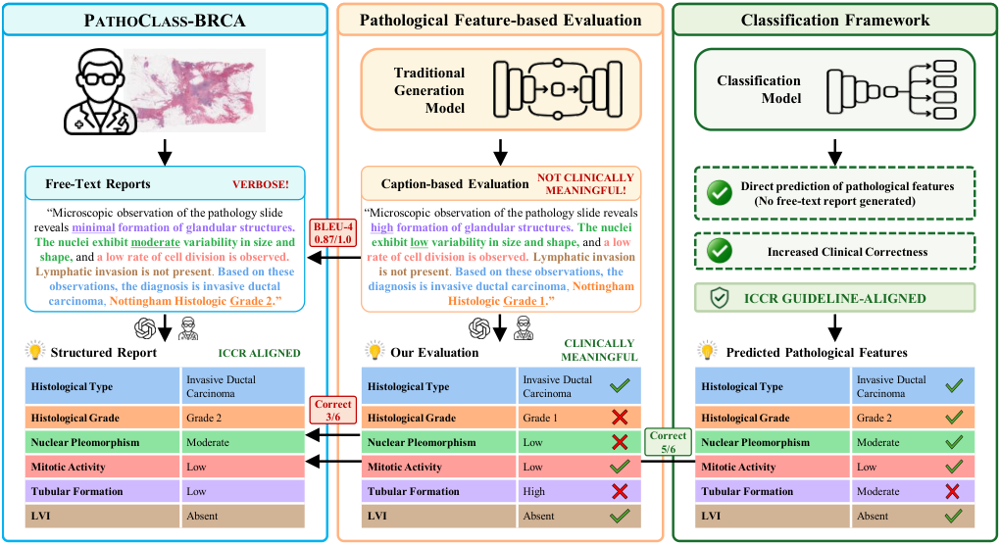
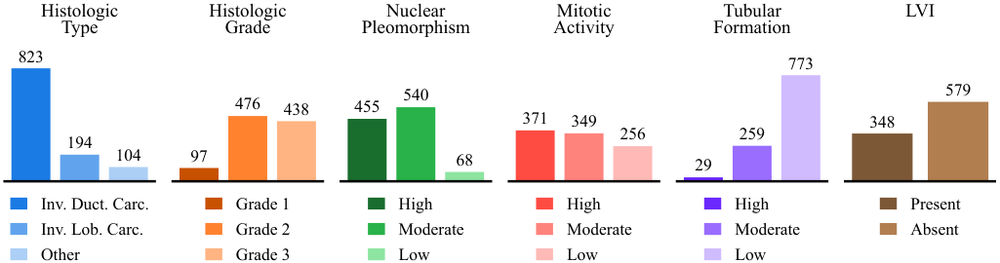

<p align="center">
    
</p>

<h3 align="center">
PathoClass-BRCA: Reframing Pathology Report Generation as Guideline-Aligned Multi-Task Classification
</h3>

<p align="center">
  <a href="https://iris.unimore.it/handle/11380/1417328"></a>
  <a href="#-citation"></a>
  <a href="#-pathoclass-brca-dataset"></a>
  <a href="LICENSE"></a>
</p>

Official implementation of **PathoClass-BRCA: Reframing Pathology Report Generation as Guideline-Aligned Multi-Task Classification** (BMVC 2026), a framework that reformulates pathology report generation from whole-slide images (WSIs) as a clinically grounded multi-task classification problem.

Prior approaches treat report generation as a captioning task and evaluate models with surface-form lexical metrics (BLEU, ROUGE, METEOR). We instead predict standardized pathological features defined by the **ICCR** reporting guidelines, enabling evaluation based on **diagnostic correctness** rather than linguistic similarity.

<p align="center">
    
    <br/>
    <em>Left: label-extraction pipeline. Centre: pathological feature-level evaluation protocol. Right: classification-oriented reformulation.</em>
</p>

---

## 📑 Contents

- [📑 Contents](#-contents)
- [📜 Overview](#-overview)
  - [Motivation](#motivation)
  - [Contributions](#contributions)
- [🛠️ Installation](#️-installation)
- [🏥 PathoClass-BRCA Dataset](#-pathoclass-brca-dataset)
- [🔬 Data Preparation](#-data-preparation)
  - [1. Downloading TCGA Slides](#1-downloading-tcga-slides)
  - [2. Whole-Slide Image Processing](#2-whole-slide-image-processing)
  - [3. Feature Extraction](#3-feature-extraction)
- [🚀 Training](#-training)
- [📊 Evaluation](#-evaluation)
- [🔗 Citation](#-citation)
- [References](#references)

---

## 📜 Overview

### Motivation

Histopathology is the gold standard for cancer diagnosis, and pathology reports are central to therapeutic planning and prognostic assessment. Recent works automate report generation from WSIs with multimodal LLMs, but most methods:

- optimise token-level cross-entropy losses designed for captioning;
- evaluate with n-gram overlap metrics;
- reward **linguistic** similarity rather than **clinical** correctness.

We reformulate report generation as a **six-task, guideline-aligned classification problem**, explicitly predicting the morphological features routinely assessed in invasive breast carcinoma.

### Contributions

| | Contribution | Where in the repo |
|---|---|---|
| **i** | **PathoClass-BRCA**, the first breast cancer WSI benchmark reframing report generation as multi-task classification over six ICCR-aligned features | [`dataset/`](#-pathoclass-brca-dataset) |
| **ii** | A **pathological feature-level semantic evaluation protocol** mapping free-text reports to guideline-defined labels via LLM extraction, scored with macro-F1 / macro-recall | [`evaluation/`](#-evaluation) |
| **iii** | **Classification-oriented adaptations** of report generation backbones using learnable task prompts and multi-head classifiers | [`models/*_classification.py`](docs/TRAINING.md) |

**The six pathological features**

| Task (`--tasks` name) | Classes | Coverage |
|---|---|---|
| `diagnosis` (histological type) | Invasive ductal / unspecified, invasive lobular, other | 100.0% |
| `grade` (histological grade) | Grade 1, Grade 2, Grade 3 | 90.2% |
| `nuclear_pleomorphism` | High, Moderate, Low/absent | 94.8% |
| `mitotic_activity` | High, Moderate, Low/absent | 87.1% |
| `tubular_formation` | High, Moderate, Low/absent | 94.7% |
| `LVI` (lymphovascular invasion) | Present, Absent | 82.7% |

---

## 🛠️ Installation

```bash
git clone https://github.com/AImageLab-zip/PathoClassBRCA.git
cd PathoClassBRCA

conda create -n pathoclass python=3.10
conda activate pathoclass
pip install -r requirements.txt
```

Experiments were run with **PyTorch 2.7.1** on **NVIDIA L40S (48 GB)** GPUs.

---

## 🏥 PathoClass-BRCA Dataset

We publicly release PathoClass-BRCA, a classification-oriented benchmark for breast cancer WSIs built on top of the BRCA subset of [WSI-Bench](https://github.com/XinhengLyu/WSI-LLaVA). Preliminary labels are extracted from free-text reports with GPT-5 using feature-specific prompts, then reviewed and corrected by pathologists (**96.7%** agreement between automatic and pathologist-verified labels).

```
dataset/
├── classification/                           ← ★ PathoClass-BRCA (this work)
│   └── BRCA/
│       ├── feature_datasets/                 Per-feature labels
│       │   ├── diagnosis_dataset.json
│       │   ├── grade_dataset.json
│       │   ├── nuclear_pleomorphism_dataset.json
│       │   ├── mitotic_activity_dataset.json
│       │   ├── glandular_tubular_formation_dataset.json
│       │   └── vascular_lymphovascular_invasion_dataset.json
│       └── splits/                           
│           ├── train_multitask.json
│           ├── val_multitask.json
│           └── test_multitask.json
│
└── report_generation/                        Source reports, from WSI-Bench BRCA
    └── BRCA/
        ├── WSI-Bench-train-report.json
        ├── WSI-Bench-val-report.json
        ├── WSI-Bench-test-report.json
        ├── short_wsi_bench.json              Sentence corpus for BiGen retrieval
        └── split_3_wsi_bench.csv             Slide-level train/val/test partition
```


- **`classification/`** — **PathoClass-BRCA**, our contribution: multi-task annotations mapping each `slide_id` to the six ICCR-aligned feature labels (`-1` = not documented in the report).
- **`report_generation/`** — the free-text reports from the BRCA subset of [WSI-Bench](https://github.com/XinhengLyu/WSI-LLaVA), from which those labels are extracted. 


**Label distribution**
<p align="center">  <br/> <em>Label distributions for the six selected pathological features (after pathologist review).</em> </p>

Several tasks are strongly imbalanced — most visibly histological type (73% invasive ductal) and tubular formation (773 low/absent vs 29 high).

---

## 🔬 Data Preparation

### 1. Downloading TCGA Slides

Diagnostic WSIs (`.svs`) are available from the [NIH Genomic Data Commons Data Portal](https://portal.gdc.cancer.gov/). TCGA-BRCA (Breast Invasive Carcinoma) slides can be retrieved with the [GDC Data Transfer Tool](https://docs.gdc.cancer.gov/Data_Transfer_Tool/Users_Guide/Data_Download_and_Upload/).

### 2. Whole-Slide Image Processing

Tissue regions are segmented with Otsu's thresholding on a downsampled WSI via OpenSlide, and non-overlapping **256 × 256** patches are extracted at **20×** magnification. We use [CLAM](https://github.com/mahmoodlab/CLAM) for the whole pre-processing stage:

```bash
python CLAM/create_patches_fp.py \
    --source <SVS_DIR> \
    --save_dir <PATCH_DIR> \
    --patch_size 256 \
    --step_size 256 \
    --seg --patch --stitch
```

### 3. Feature Extraction

To extract embeddings with UNI, PLIP or GigaPath, refer to `extract_embeddings/` and its own [README](docs/FEATURE_EXTRACTION.md), which describes the scripts and how to launch them in detail.

## 🚀 Training
All models are trained through `main.py`, which handles both paradigms: adding `--classification` switches from free-text report generation to multi-task classification — see the [training guide](docs/TRAINING.md) for the full command of every model and paradigm.

## 📊 Evaluation

**Generative models (pathological feature-level evaluation protocol)**

Free-text reports produced by MiGen / HistGen / BiGen / WSI-LLaVA are mapped to the six standardized labels with the feature-specific prompts in `evaluation/prompts.py`, then scored against PathoClass-BRCA ground truth. Two scripts are provided, differing only in the format of the predictions they read:

- [extract_labels_multitask_from_report.py](evaluation/extract_labels_multitask_from_report.py) to evaluate MiGen, HistGen, BiGen;
- [extract_labels_multitask_from_report_wsi_llava.py](evaluation/extract_labels_multitask_from_report_wsi_llava.py) to evaluate WSI-LLaVA.

```bash
python -m evaluation.extract_labels_multitask_from_report \
    --root <PREDICTIONS_DIR> \
    --gt dataset/classification/BRCA/splits/test_multitask.json \
    --model <MODEL_NAME> \
    --save_name <SAVE_NAME> \
    --model_type gpt-5 \
    --tasks all
```
`root` is a directory of `.txt` files, one per sample, each holding a Python dict with `predict` / `target`.
`--tasks` is a comma-separated subset of the six task names, or `all` (default).


```bash
python -m evaluation.extract_labels_multitask_from_report_wsi_llava \
    --jsonl <PREDICTIONS_FILE>  `# JSONL predictions` \
    --text_field answer         `# which JSON field to score` \
    --gt dataset/classification/BRCA/splits/test_multitask.json \
    --model <MODEL_NAME>        `# label only: results/<model>/` \
    --save_name <SAVE_NAME>     `# suffix for the output files` \
    --model_type gpt-5          `# OpenAI model used for extraction` \
    --tasks all                 `# tasks to score, or a comma-separated subset`
```

Each run writes three things under `classification/results/<model>/`: a `metrics_*.txt` log, a `preds_*.csv` with one row per (sample, task), and a `gpt_cache_*/` directory. **Extraction results are cached per sample and task**, so re-running after a crash — or with a different `--tasks` subset — only issues the missing API calls.

The scripts:
1. extract structured pathological features from each generated report via LLM prompting;
2. maps the extracted text back to a label using the vocabulary built from the ground truth; unmappable answers are logged as `PRED_TEXT_NOT_IN_ALLOWED` and dropped;
3. discard samples whose ground-truth label is `-1`;
4. compute macro-F1 and macro-recall against the ground truth.

> If the ground truth is available and the model omits the feature, i.e. the feature label is `-1`, this case is counted as an error for the true class. 
> Pathologists reviewed labels extracted from 1,500 generated reports; the extraction protocol reaches **96.4%** concordance in identifying the intended feature values.

⚠️ This step queries an external LLM. Export your API key before running:
```bash
export OPENAI_API_KEY=<YOUR_KEY>
```

---

## 🔗 Citation

If you find this code or dataset useful, please cite our paper:

```bibtex
@inproceedings{saporita2026pathoclass,
  title={PathoClass-BRCA: Reframing Pathology Report Generation as Guideline-Aligned Multi-Task Classification},
  author={Saporita, Alessia and Pipoli, Vittorio and Bolelli, Federico and Baraldi, Lorenzo and Acquaviva, Andrea and Ficarra, Elisa and others},
  booktitle={37th British Machine Vision Conference, BMVC 2026},
  year={2026}
}
```

---

## References
- [MI-Gen / WsiCaption](https://github.com/cpystan/Wsi-Caption) — *Multiple Instance Generation of Pathology Reports for Gigapixel Whole-Slide Images*, MICCAI 2024. 
- [HistGen](https://github.com/dddavid4real/HistGen) — *Histopathology Report Generation via Local-Global Feature Encoding and Cross-modal Context Interaction*, MICCAI 2024.
- [BiGen](https://github.com/DeepMed-Lab-ECNU/BiGen) — *Historical Report Guided Bi-modal Concurrent Learning for Pathology Report Generation*, MICCAI 2025. 
- [WSI-LLaVA](https://github.com/XinhengLyu/WSI-LLaVA) — *A Multimodal Large Language Model for Whole Slide Image*, ICCV 2025. 
- [UNI](https://github.com/mahmoodlab/UNI) — *Towards a general-purpose foundation model for computational pathology*, Nature Medicine, 2024.
- [PLIP](https://github.com/PathologyFoundation/plip) — *A visual–language foundation model for pathology image analysis using medical Twitter*, Nature Medicine, 2023. 
- [Prov-GigaPath](https://github.com/prov-gigapath/prov-gigapath) — *A whole-slide foundation model for digital pathology from real-world data*, Nature, 2024. 
- [CLAM](https://github.com/mahmoodlab/CLAM) — *Data-efficient and weakly supervised computational pathology on whole-slide images*, Nature Biomedical Engineering, 2021. 
- TCGA — [NIH Genomic Data Commons](https://portal.gdc.cancer.gov/)
- ICCR — [International Collaboration on Cancer Reporting](https://www.iccr-cancer.org/), invasive breast carcinoma dataset